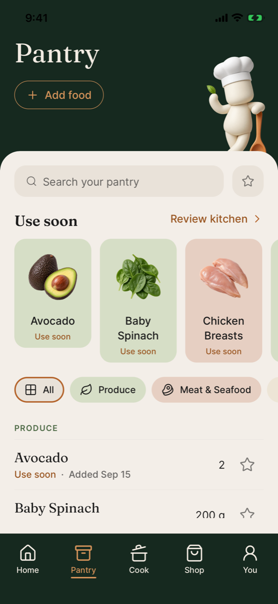
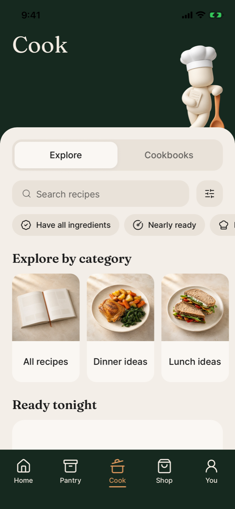
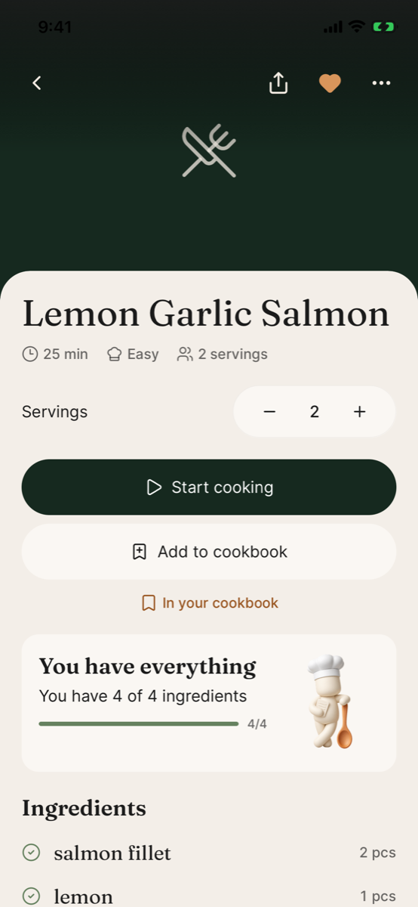
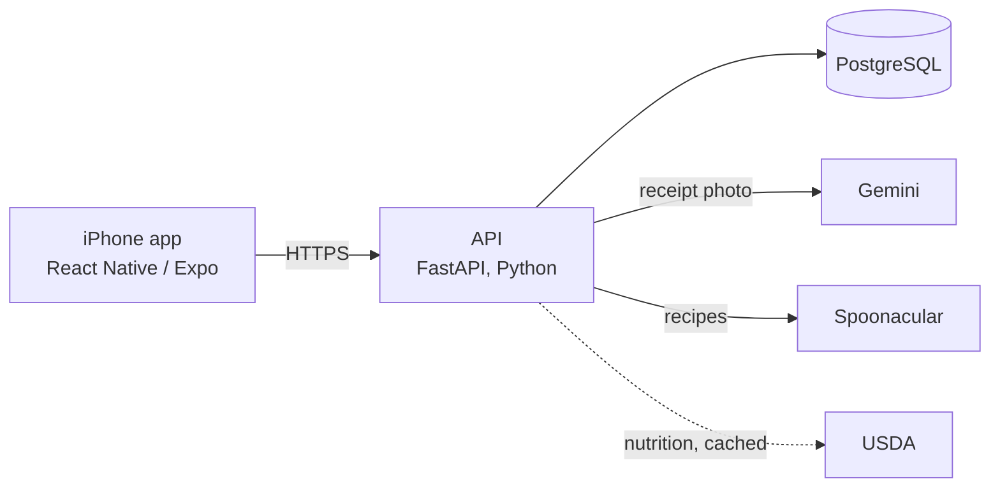

# SousChef

A live version of my pantry on my phone, and a cook that helps me decide what to make from it.

## Why I built it

When I moved to Zurich for my master's I started living on my own for the first time. One thing surprised me: deciding what to eat every day took up a lot of mental capacity. It felt like such a trivial thing to spend that much thought on. Talking with friends and colleagues, I was clearly not the only young adult with this problem.

My first fix was a shopping list in the Notes app. It did not feel intelligent. I would add a line, buy the thing, forget to delete the line, and buy it again, or stand in the shop doubting the list. After a while the list lost its validity.

So I wanted two things. First, a live inventory: at any time, look at my phone and see what I have at home, so I do not buy what I already own and I notice when I am low on a staple like butter. Second, an intelligent layer on top of that inventory, so I do not have to decide alone what to cook. If the app knows what is in the kitchen, it can suggest a dinner I can make tonight without a trip to the store.

I started SousChef in March 2026, around the time agent coding tools like Claude Code and Codex came out. I wanted real experience with them, and this was the project I actually needed.

## How I use it

I use it every week. For simple meals like eggs I do not open it. When I want a new kind of dinner I go into Cook and see what it finds from what I have. I am also learning to cook, and I like building a repertoire of dishes I come back to.

The best example so far: SousChef pointed me to a Moroccan chicken recipe I had never tried, let alone made. It is now one of my favourites and I cook it every couple of weeks. On busy weeks, between studies and everything else, it is just as good at finding something simple and quick.

The next step is to get it into the hands of some friends and family.

## The app

| Pantry | Cook | Recipe |
| :---: | :---: | :---: |
|  |  |  |

- **Pantry.** Everything at home, what to use soon, and a search. Each purchase is tracked on its own, so "use soon" means the oldest milk, not milk in general.
- **Scan.** Photograph a receipt after shopping. The app reads it, I check the lines, and the pantry updates. Items that were on my list get ticked off.
- **Cook.** Recipes ranked by how much of them I already have, with filters for what needs using up. A recipe shows what I am missing and adds it to the list in one tap.
- **Shop.** The list, by aisle or by recipe. Bought items go straight into the pantry.
- **Kitchen Review.** A quick pass over what is close to its date: still good, used it, or gone.

All nine screens are in [media/screenshots](media/screenshots). Four short recordings of real flows are in [media/gifs](media/gifs).

## How it is built

The iPhone app is TypeScript and the API is Python, in two private repos. If you want to read the code, ask me and I will share them.

I built it with Claude Code as the main tool. What I brought was the software engineering from my degree: the data model, the API boundaries, and the decisions that keep the backend easy to extend. The agent wrote most of the code inside those decisions, and I reviewed every change. Anyone can vibe-code an app. The part I am proud of is that I used my background to build something I can keep adding to, so that as new AI tools, features and systems come out I have a real project to try them in and learn from.

The five decisions that shaped it, and what each one cost, are in [docs/decisions.md](docs/decisions.md). The things that went wrong, and what I changed because of them, are in [docs/lessons.md](docs/lessons.md).

## What I want to build next

- **An agent that picks dinner.** The pantry already knows what is at home. The next layer is an assistant you can talk to: what do I want, how much time do I have, and it proposes meals I can make with what is here.
- **More than one cook.** Share a pantry with the people you live with.
- **A place for aspiring chefs.** Friends in culinary school and young cooks promote their meals on general social platforms. A kitchen app that knows what you have at home seems like a natural place for them to show a dish you could make tonight.

## License

MIT. See [LICENSE](LICENSE).
